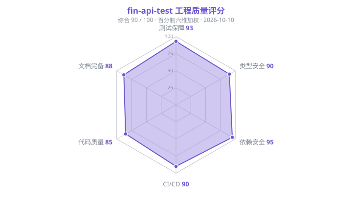

# 工程质量评分卡

> **文档版本**:v1.0
> **评分日期**:2026-09-06
> **基准提交**:`c9d0e56`（main）
> **评分对象**:fin-api-test 全仓库（测试平台前后端 + 根目录五层用例工程）
> **维护说明**:每次质量专项改进后追加一轮记录,评分依据须为可验证的客观证据(CI 结果、测试计数、扫描报告)。

---

## 1. 综合得分

**84 / 100**(百分制六维加权)

```
综合分 = Σ(维度得分 × 维度权重)
       = 85×0.20 + 80×0.15 + 95×0.15 + 85×0.20 + 80×0.20 + 75×0.10
       = 83.75 ≈ 84
```

## 2. 评分雷达图



## 3. 六维评分明细

| 维度 | 权重 | 得分 | 加权分 | 评分依据 |
|---|---|---|---|---|
| 测试保障 | 20% | 85 | 17.0 | 后端 pytest 734 通过(37 个测试文件),前端 vitest 72 通过(7 个套件),均已纳入双平台 CI 强制卡点 |
| 类型安全 | 15% | 80 | 12.0 | 后端 mypy 0 错误(58 源文件,SQLAlchemy 2.0 插件,Basic 档严格配置),前端 vue-tsc --noEmit 零错误;CI 中 mypy job 暂为 advisory 模式 |
| 依赖安全 | 15% | 95 | 14.25 | GitHub Dependabot 开放告警 0;SQLAlchemy 2.0.52 兼容 Python 3.14 |
| CI/CD | 20% | 85 | 17.0 | GitHub Actions 5 job 全绿(ruff / pytest / mypy / vue-tsc+build / vitest),GitLab CI 同步运行,pre-commit 本地钩子(ruff、mypy、vue-tsc、vitest、YAML/JSON 校验) |
| 代码质量 | 20% | 80 | 16.0 | ruff(pyflakes F)零告警;ORM 统一 SQLAlchemy 2.0 类型化 `mapped_column` 写法;19,018 行 Python / 143 文件结构清晰,分层(routers/services/crud/engine)一致 |
| 文档完备 | 10% | 75 | 7.5 | `docs/SYSTEM_DESIGN.md`(系统设计)+ `docs/CONTEXT.md`(项目上下文)+ 根 README;暂缺 API 参考文档与部署运维手册 |

## 4. 证据快照(2026-09-06)

| 指标 | 数值 | 来源 |
|---|---|---|
| 后端测试 | 734 passed | `pytest tests -q`(本地)+ GitHub Actions `Backend Tests` job |
| 前端测试 | 72 passed / 7 files | `npm run test` + GitHub Actions `Frontend Unit Tests` job |
| mypy 错误 | 0 | `mypy app`,GitHub Actions `Backend Type Check` job |
| vue-tsc 错误 | 0 | GitHub Actions `Frontend Typecheck & Build` job |
| Dependabot 开放告警 | 0 | GitHub Security Advisories API 实时查询 |
| Python 规模 | 143 文件 / 19,018 行 | `git ls-files "*.py"` |
| CI 状态 | 5/5 job success | commit `c9d0e56` check-runs |

## 5. 提升路线(下一轮目标 ≥ 90)

1. **mypy 转 blocking**:移除 CI 中 `continue-on-error: true`,作为强制卡点(类型安全 → 90)。
2. **覆盖率量化**:接入 `pytest-cov` / `vitest --coverage`,在后端 services/engine 层建立行覆盖率基线并纳入报告(测试保障 → 92)。
3. **API 文档**:FastAPI 自带 OpenAPI schema 导出为 Markdown/引用文档,补齐 docs/(文档完备 → 85)。
4. **前端组件测试**:当前 vitest 覆盖 utils 层,可扩展到核心组件(命令面板、用例编排画布)的挂载交互测试。

---

## 6. 第二轮记录(2026-10-10,架构改进 8 候选)

**基准提交**:`0c17c3c`(dev/main)。八候选分 6 批落地,每批独立 commit + 全量护栏:

| 批 | commit | 内容 |
|---|---|---|
| 1 死代码+术语 | `bb1e94d` | 删 engine/expression.py(327 行)等死代码;preprocessor.py→nested_path.py、row_vars→dataset_row 术语收口;CONTEXT.md 词条重写 |
| 2 性能+契约 | `f92cf2c` | dag_executor 节点/接口缓存预载消除 N+1;DbSink flush 收口;422 折叠;25+ 路由补 response_model;stats 改 SQL 聚合 |
| 3 _execute_node 收深 | `612f855` | _step_event/_extract_and_assert/_assertion_events 样板收口;report_context 公开 iter_body_paths/iter_replay_paths |
| 4 replay 出路由 | `92a99de` | 新建 services/replay_service.py,executions 两路由瘦成 2 行委托 |
| 5 前端 SQL 收敛 | `e1c6b4c` | 新建 useSqlInsert + SqlCell,三处复制的 SQL 插入逻辑收敛 |
| 6 巨型视图拆分 | `0c17c3c` | 新建 useRefGroups/ImportJsonDialog/ReplayDialog/clipboard,DatasetManage 1083→约 880 行、ReportDetail 1390→约 1240 行 |

**证据快照**(2026-10-10,本地全量):

| 指标 | 数值 | 来源 |
|---|---|---|
| 后端测试 | 759 passed(46 文件) | `pytest tests -q` |
| 前端测试 | 72 passed / 7 files | `npm run test` |
| vue-tsc / 构建 | 0 错误 / 7.82s 成功 | `npx vue-tsc --noEmit` / `npm run build` |

> 本轮为质量加固未动功能面,不重算六维得分;下一轮评分时测试保障/代码质量两维按新证据取数。
